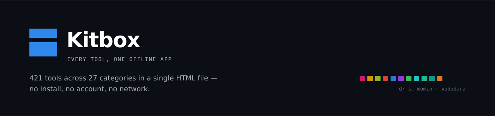
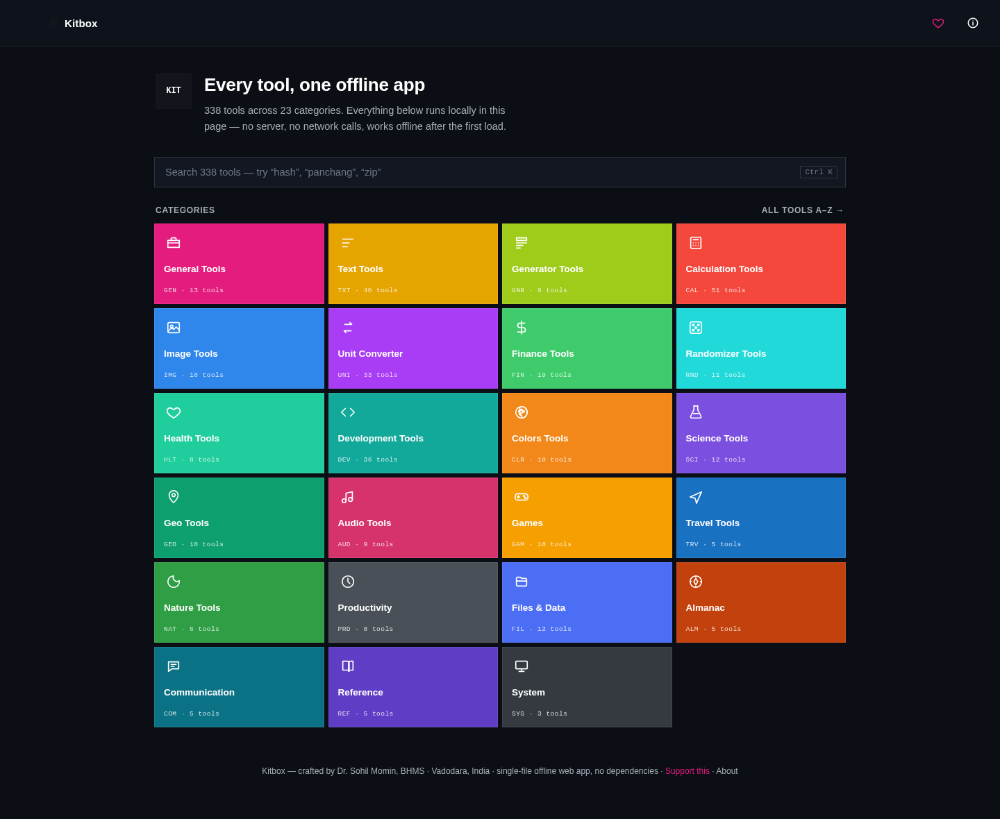
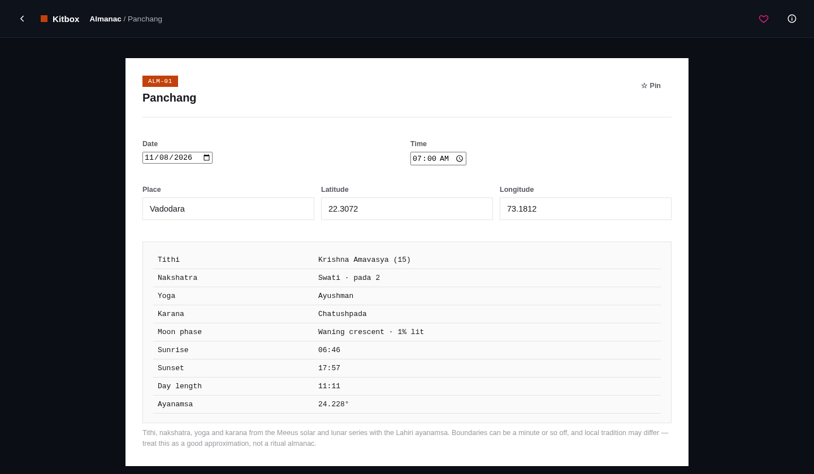
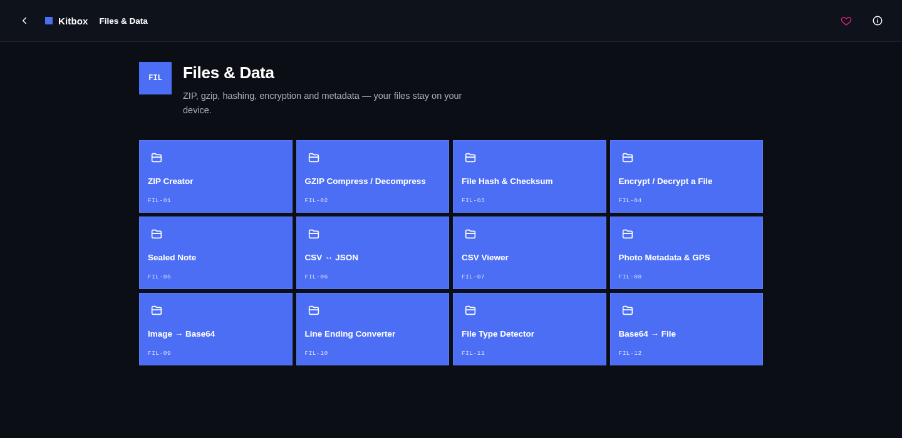
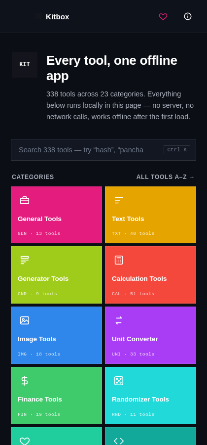
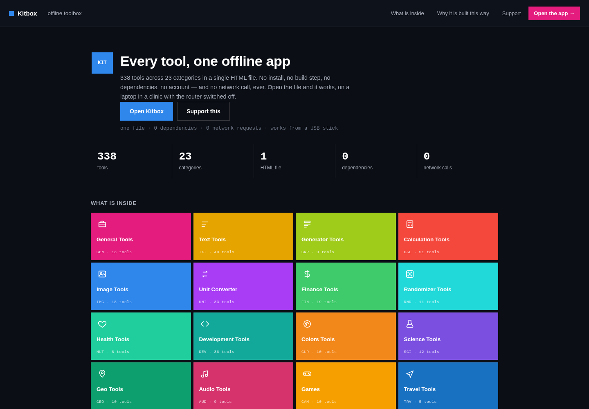

<div align="center">



<br>

<a href="https://github.com/drsamonline/kitbox/releases/latest"></a>
<a href="kitbox.html"></a>
<a href="#categories"></a>
<a href="#tests"></a>
<a href="#what-it-refuses-to-do"></a>
<a href="#what-it-is"></a>
<a href="#what-it-is"></a>
<a href="#what-it-is"></a>
<a href="LICENSE"></a>

<br><br>

<strong>412 tools across 27 categories in one HTML file.</strong><br>
No install, no build step, no dependencies, no account — and no network call, ever.

<br>

<a href="https://drsamonline.github.io/kitbox/kitbox.html"><strong>Open the live app →</strong></a> &nbsp;·&nbsp;
<a href="https://drsamonline.github.io/kitbox/">Landing page</a> &nbsp;·&nbsp;
<a href="#categories">What's inside</a> &nbsp;·&nbsp;
<a href="ROADMAP.md">Roadmap</a> &nbsp;·&nbsp;
<a href="BACKLOG-TOOLS.md">Tools to add</a> &nbsp;·&nbsp;
<a href="PLAN.md">Plan</a> &nbsp;·&nbsp;
<a href="#support">Support</a>

</div>

<br>



<p align="center"><sub>One search box over 412 tools. Pinned and recent tools appear above the categories once you have used it for a day.</sub></p>

---

**Live demo:** [drsamonline.github.io/kitbox](https://drsamonline.github.io/kitbox/) — the same single file, served over https. A fixed URL, [/latest/](https://drsamonline.github.io/kitbox/latest/), always serves the current build. Download it from a [release](../../releases) and it works with the network off.

## What it is

|  |  |  |
|:--|:--|:--|
| 🧰 **412 tools** | 🗂️ **27 categories** | 📄 **1 HTML file** |
| 📦 **0 dependencies** | 🔌 **0 network calls** | 👤 **0 accounts** |

Save the file. Open it from a USB stick on a machine with the router switched off. It works — that is the entire design brief, and everything below follows from it.

**Who it is for:** the consulting room with no reliable internet, the classroom with filtered Wi-Fi, the old laptop kept offline on purpose, and anyone who would rather not upload a patient's lab report to a website to convert it to PDF.

## Categories

| | Category | Tools | What it covers |
|:--:|:--|--:|:--|
| 🧰 | General | 13 | Ruler, counters, countdown, stopwatch, Morse, Roman numerals, compass, level, world clock, text-to-speech, big clock |
| ✍️ | Text | 47 | Case, find and replace, sorting, ciphers, slugify, braille, ASCII banners, readability, keywords, accents, smart quotes, invisible characters |
| ✨ | Generator | 10 | QR codes, Lorem Ipsum, number generators, barcode scanning, passphrases, usernames |
| 🧮 | Calculation | 54 | Everyday maths, algebra, geometry and solids, statistics, regression, dates, sleep cycles, rounding, fuel and electricity cost, pricing |
| 🖼️ | Image | 18 | Resize, crop, compress, convert, filters, collage, ASCII art — all local |
| 📐 | Unit converter | 33 | Length, mass, volume, energy, pressure, data, typography, paper sizes, shoe sizes |
| 💰 | Finance | 19 | EMI, investment, tax, amortisation, savings goal, debt payoff, simple interest, SIP, GST split |
| 🎲 | Randomizer | 11 | Wheel, dice, coin, rock-paper-scissors, random from a list, PINs, teams, 8-ball |
| ❤️ | Health | 8 | BMI, BMR, water, ideal weight, clinical calculations, TDEE and macros, heart-rate zones, due date |
| ⌨️ | Development | 56 | JSON and schema, YAML, base64, hashes, HMAC, JWT, certificates, ASN.1, cron, ULID, CIDR, MIME, Markdown, configs, regex, SQL, CSS clamp |
| 🎨 | Colours | 10 | Picker, blend, WCAG contrast, colour-blindness simulation, palette from an image, harmony, tints and shades |
| ⚗️ | Science | 17 | Ohm's law, molar mass, pH, half-life, density, wavelength, periodic table, ideal gas, projectiles, molarity |
| 🧭 | Geo | 10 | Distance, bearing, midpoint, DMS, sunrise, GPS speed, polygon area, antipodes, cardinal points, coordinate rounding |
| 🎵 | Audio | 10 | Tone generator, metronome, noise, binaural beats, decibel meter, recorder, tap tempo, Hz to note |
| 🕹️ | Games | 13 | Tic-tac-toe, memory, hangman, Wordle, Simon, trivia, reaction time, typing speed, 2048, minesweeper, snake |
| ✈️ | Travel | 5 | Packing lists, flight duration, bag sizes, plug types, flight carbon |
| 🌙 | Nature | 6 | Moon phase, solstices, sun exposure, night-sky brightness, golden hour, day length |
| ⏱️ | Productivity | 8 | Pomodoro, habits, notepad, sketch pad, flashcards, backup and restore, checklists, meeting cost |
| 📁 | Files & Data | 13 | ZIP create and extract, gzip, hashing, encryption, sealed notes, CSV, EXIF and GPS, base64 both ways, file type detection |
| ☀️ | Almanac | 8 | Panchang, rahu kaal, sun and moon times, planetary hours, tithi calendar |
| ✉️ | Communication | 5 | vCard, calendar invites, message links, SMS counting, phone formatting |
| 📚 | Reference | 5 | ASCII table, Big-O cheatsheet, regex cheatsheet, country dial codes, keyboard shortcuts |
| 🖥️ | System | 4 | Device and screen info, error log, browser feature check, local storage usage |
| ♿ | Accessibility | 9 | Reading ruler, dyslexia-friendly preview, text spacing checker, alt text checker, focus ring preview |
| 🎓 | Education | 4 | Multiplication table, times table quiz, unit circle, formula sheet |
| 🩺 | Clinical | 12 | Paediatric dose, IV drip rate, eGFR, corrected calcium, GCS, CURB-65, qSOFA, Wells DVT and PE, CHA₂DS₂-VASc, HAS-BLED, Child-Pugh |
| ₹ | Money (India) | 4 | HRA exemption, EPF corpus, gratuity, PPF and FD maturity |

## A look inside

<table>
<tr>
<td width="50%"><br><sub><b>Almanac → Panchang.</b> Meeus solar and lunar series, Lahiri ayanamsa, computed for your coordinates.</sub></td>
<td width="50%"><br><sub><b>Files &amp; Data.</b> Twelve tools that read your file in the page and hand it back — nothing uploaded.</sub></td>
</tr>
<tr>
<td><br><sub><b>On a phone.</b> The same file, two columns, no separate mobile build.</sub></td>
<td><br><sub><b>The landing page.</b> Built from the app's own stylesheet, so the two cannot drift.</sub></td>
</tr>
</table>

## Finding a tool

| Key | Does |
|:--|:--|
| <kbd>Ctrl</kbd> <kbd>K</kbd> / <kbd>⌘</kbd> <kbd>K</kbd> | Search all 412 tools from anywhere |
| <kbd>/</kbd> | The same search, when you are not already typing |
| <kbd>↑</kbd> <kbd>↓</kbd> <kbd>↵</kbd> | Move through results, open one |
| <kbd>Esc</kbd> | Close the search, then step back a page |

Ranking is exact name, then prefix, then word start, then substring, then an ordered-letters fallback — so `panchng` still finds Panchang. **Pin** a tool with the star on its page and it moves to the top of the home screen, beside your recents.

## Getting it

```bash
git clone https://github.com/drsamonline/kitbox.git
cd kitbox
open kitbox.html        # macOS   (xdg-open on Linux, start on Windows)
```

Or serve it: `python3 -m http.server`, then visit `http://localhost:8000`. Both work — the app has no dependency on being served.

## What it refuses to do

| | |
|:--|:--|
| 🚫 **No network calls** | Not for updates, not for fonts, not for analytics. The test suite fails if a `fetch`, `XMLHttpRequest`, `WebSocket` or `EventSource` appears in the file, or if an external script, stylesheet, font or image is added. |
| 📤 **No silent uploads** | Files are read with `FileReader` and written with `Blob` and `a[download]`. There is no server to send them to. |
| 📊 **No telemetry** | Nothing is counted, profiled or reported. |
| 👤 **No account** | There is nothing to sign into. |
| 🔗 **Almost no outbound links** | Exactly one page has them: Support, where Ko-fi, PayPal, the book store and the email address are links you may choose to click. The page loads none of them. |

## Where the tools came from

Kitbox began as one file with 239 tools. It has grown in two passes, all rewritten to run inside this page:

| From | Brought over |
|:--|:--|
| `export-kit` | Store-only ZIP writer (local headers, central directory, CRC32) |
| `compress-kit` | GZIP compress and decompress over Compression Streams |
| `crypto-kit` | AES-256-GCM with PBKDF2-SHA256 keys; file encryption and sealed notes |
| `astro-kit`, `app-panchang` | Julian day, Meeus solar and lunar longitude, Lahiri ayanamsa, tithi, nakshatra, yoga, karana, rahu kaal, planetary hours |
| `app-image-toolkit` | EXIF and GPS reading, and metadata stripping that leaves pixels untouched |
| `ml-kit` | tf-idf keyword ranking and cosine similarity |
| `TTB`, `All4ONE` | Statistics, regression, sig figs, fuel and electricity cost, pricing, savings, debt payoff, ULID, base32/base58, HMAC, MD5, CIDR, MIME, Markdown, config parsing, .gitignore, vCard, ICS, message links, tap tempo, meeting cost |

## Accuracy, honestly

- 🌗 **The panchang** uses the Meeus solar and lunar series with an approximate Lahiri ayanamsa. Tithi and nakshatra boundaries land within roughly a minute of a published almanac; **they are approximations, and local tradition may differ.** The test suite pins the solar and lunar longitudes to the published Meeus worked examples.
- 🩺 **Health, finance and science calculators** use standard public formulas. They are general-purpose tools, not professional instruments — nothing here is a substitute for medical, financial or legal advice.
- 🔐 **MD5** is included for legacy checksums only. It is not collision-resistant and must never be used for passwords.
- 🔑 **File encryption** needs a secure context (https or localhost) for Web Crypto, and a lost passphrase cannot be recovered.
- 👟 **Shoe sizes and flight carbon** are rules of thumb. They compare choices; they do not fit a shoe or audit an airline.

## Tests

```bash
npm ci
npm test
```

175 checks, run against the real file in jsdom:

- every tool renders — 412 of them
- tool ids and names are unique
- all 50 routes resolve
- the ported astronomy matches Meeus 25.b and 47.a; Delhi's midsummer sunrise and sunset land where they should
- MD5, CRC32, base32 and base58 match their published check values
- the new arithmetic is pinned: A4 at 300 DPI, 18% GST, molar volume at STP, projectile range, C1V1, GSM vs UCS-2
- the support page carries the real UPI id and an inline QR
- user text is escaped, never parsed as markup
- the file loads nothing external and calls nothing over the network

```bash
node tools/check-badges.js   # the badges above are checked against the app
python3 tools/badges.py      # redraw them if a number changes
python3 tools/shots.py       # retake the screenshots (needs chromium)
```

CI runs all of that plus: the badge numbers against the app, `ALL_TOOLS.md` and the landing page against the registry, `docs/` against the markdown, `MANIFEST.json` against the tracked files, the roadmap against the plan, a scan for `eval`/`new Function`/`document.write`/`javascript:` URLs, and a size budget. Run the same set locally with `npm run check`.

The badges are local SVG files, not a badge service — an offline-first app that needs the network to say "no network" has broken its own rule. `check-badges.js` fails the build if the numbers in them drift from the app.

## Your data

Tools that remember things between visits — Notepad, Flashcards, Trivia Creator, Sketch Pad's palette, Scoreboard, Habit Tracker, Packing List, Checklists, currency rates, ruler calibration, the unit converter's last pair, pinned tools, recents, the Panchang's last location — store it in this browser's `localStorage` under the `tooly:` prefix. It never leaves the device, and clearing browser data erases it.

**Productivity → Backup & Restore** exports everything to one JSON file. **System → Local Storage Usage** shows exactly what is being held.

## Documents

| | |
|:--|:--|
| [USAGE.md](USAGE.md) | Getting it, finding a tool, working with files, when something does not work |
| [CONTRIBUTING.md](CONTRIBUTING.md) | The five rules, how a tool is written, what gets rejected |
| [SECURITY.md](SECURITY.md) | The threat model: what a single file protects against, and what it does not |
| [PRIVACY.md](PRIVACY.md) | What is stored, where, and the one page with outbound links |
| [ALL_TOOLS.md](ALL_TOOLS.md) | Every tool with its code and id, generated from the app |
| [AUDIT.md](AUDIT.md) | What was checked, what was found, what remains imperfect |
| [ROADMAP.md](ROADMAP.md) · [PLAN.md](PLAN.md) | The 119-item backlog, and the 15 batches it ships in |

## Support

<div align="center">

</div>

Free, offline, accountless — and staying that way. If it earned its keep:

| | |
|:--|:--|
| 🇮🇳 **UPI (India)** | `drsohilboi@ybl` — payee Dr. Sohil Momin, open amount, or scan the QR above |
| ☕ **Ko-fi** | [ko-fi.com/matneo](https://ko-fi.com/matneo) |
| 💳 **PayPal** | [paypal.me/drsohilmomin](https://paypal.me/drsohilmomin?locale.x=en_GB&country.x=IN) |
| 📚 **My books** | [Amazon author store](https://www.amazon.com/stores/author/B08ZT331LY/allbooks?ccs_id=aed72b9f-71d9-41dc-adee-e9368a317acc) |
| 🧰 **More apps** | [drsamonline.github.io](https://drsamonline.github.io/) |
| ✉️ **Email** | [sohilmomin2000@gmail.com](mailto:sohilmomin2000@gmail.com) |

Nothing is gated behind it: no paid tier, no account, no tracking. Supporting it buys the next version, not a feature.

## Roadmap

Every enhancement worth doing — 119 numbered items, measured where measurement was possible, each with an effort and impact rating, plus what is deliberately *not* being built and why: **[ROADMAP.md](ROADMAP.md)**.

Those 119 items are grouped into **15 shippable batches** — quick wins first, structural work later, small items merged where they share a file — in **[PLAN.md](PLAN.md)**. Fifteen batches, ~56 days, with the useful cut line at batch ten (~25 days).

## Licence

**PolyForm Noncommercial 1.0.0** — free for any noncommercial purpose. Commercial use needs a licence from the author; see [LICENSE](LICENSE). The full terms are short and worth reading once.

---

<div align="center">
<sub>Crafted by <b>Dr. Sohil Momin, BHMS</b> — Vadodara, Gujarat, India</sub><br>
<sub>One of a fleet of single-file tools. No accounts, no cloud, no lock-in.</sub>
</div>
